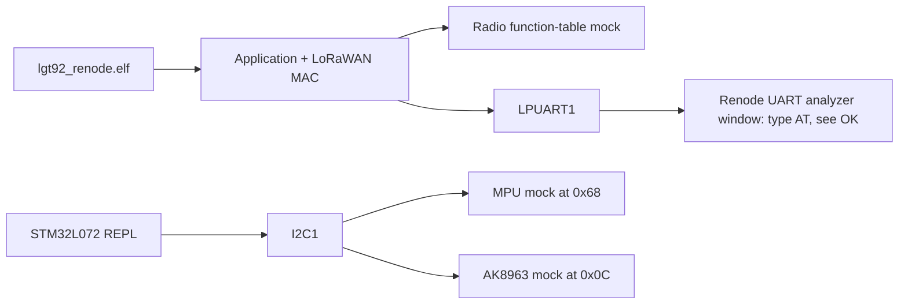

# Renode STM32L072 simulation with peripheral mocks

## Outcome

Create a repeatable Renode setup under a new `renode/` directory, build a separate simulation ELF that binds a firmware-side mock `Radio` instead of the SX1276, attach a Renode-level MPU9250/AK8963 I2C register mock, then smoke-test boot and the LPUART `AT` response. Keep the default production target and generated STM32 initialization/HAL files unchanged.

## Recommended approach

1. **Add a separate simulation firmware target in** **`CMakeLists.txt`.** Factor the common application/LoRa sources so the new `lgt92_renode.elf` target uses the same LoRaWAN stack and application while selecting `renode/radio_mock.c` as the sole definition of the global `Radio`. Omit `Drivers/BSP/Components/sx1276/sx1276.c` and `Drivers/BSP/sx1276mb1las/sx1276mb1las.c` from this target; retain the normal target and its SX1276 binding unchanged. Implement the complete `struct Radio_s` table with deterministic, hardware-free behavior and no SPI/register access.

2. **Make the existing LSI-measurement startup compatible with simulation.** In the project-owned `Drivers/BSP/Components/iwdg/iwdg.c`, add a `RENODE_SIMULATION`-only path that uses a fixed nominal LSI value (32 kHz) instead of waiting for TIM21 input-capture edges. Keep the production path unchanged. This is needed because the installed STM32L072 model does not implement the TIM21 `OR` LSI remap used by `GetLSIFrequency()`; the firmware otherwise stalls in `while (uwCaptureNumber != 2)` before reaching its main loop ([`iwdg.c`](../../Drivers/BSP/Components/iwdg/iwdg.c#L105-L164)).

3. **Create the Renode platform and MPU mock under** **`renode/`.** Add `lgt92-stm32l072.repl` using Renode's installed `platforms/cpus/stm32l072.repl`, then register two `Mocks.DummyI2CSlave` targets on its I2C1 bus: MPU address `0x68` and the MPU9250's companion AK8963 magnetometer address `0x0C`. Add `mpu9250.py`, loaded by the `.resc` script, to implement register-pointer, sequential reads, writable configuration registers, and transaction reset behavior via the dummy-slave `DataReceived`, `ReadRequested`, and transmission-finished events.

   Populate the register values the application checks: MPU `WHO_AM_I` at `0x75` returns `0x71` (accepted by this driver); AK8963 `WIA` at `0x00` returns `0x48`; provide deterministic accelerometer bytes at `0x3B–0x40` and accept the configuration writes from `MPU_Init()`/`MPU_INT_Init()`. The driver uses hardware I2C1, not GPIO bit-banging ([`IIC.c`](../../Drivers/BSP/Components/IIC/IIC.c#L49-L111), [`stm32l0xx_hw_conf.h`](../../Projects/Multi/Applications/LoRa/DRAGINO-LRWAN%28AT%29/inc/stm32l0xx_hw_conf.h#L171-L191)).

4. **Add a reusable GUI launch script and interactive smoke procedure.** Add `lgt92.resc` to load the platform, attach/load the I2C mock, define a reset macro that reloads the simulation ELF, open a dedicated UART analyzer with `showAnalyzer sysbus.lpuart1`, and start emulation. Run Renode in its normal GUI mode (do not disable XWT or create a host socket); the analyzer window is the user's terminal for viewing output and typing AT commands. Handle the firmware's first-boot EEPROM/version reset path and verify that the model preserves the written configuration across reset ([`lora.c`](../../Projects/Multi/Applications/LoRa/DRAGINO-LRWAN%28AT%29/src/lora.c#L1432-L1451)). Smoke-test interactively by entering `AT` in that window and confirming the firmware responds `OK`. Keep build outputs in a separate `build/renode/` directory.

## Validation and reporting

* Configure/build only the simulation target in its separate build directory; require its ELF to link with the mock `Radio` and without SX1276 driver/board-binding objects. Confirm the existing production target configuration remains the default.

* Launch the `.resc` script in Renode GUI mode. In the dedicated LPUART1 analyzer window, enter `AT`; success means the machine survives startup/reset, reaches the command-processing loop, and displays the firmware's `OK` response. No socket terminal or separate host-side smoke client is needed.

* Confirm I2C1 maps both mock addresses and that register identity/data responses are correct when the firmware accesses them. Since MPU initialization occurs in the application send path after LoRaWAN join, report whether the smoke boot actually exercises those transactions rather than implying it did.

* Capture Renode console output to a log. Report each true unmapped system-bus read separately from accesses to modeled peripherals with unimplemented registers; include address, access type, PC/call-site where available, and the likely missing model/incorrect mapping/unused access root cause. Add only evidence-based platform overrides; do not blanket-map address ranges.

* Do not add Robot Framework tests, socket terminals, or a separate host-side smoke client; do not simulate the SX1276, alter production radio behavior, or edit generated STM32 HAL/initialization code.

## Evidence and assumptions

* The installed Renode 1.17 STM32L072 description includes I2C1 and LPUART1; its base description is `platforms/cpus/stm32l072.repl`, with `i2c1` defined in the included `stm32l071.repl` at `0x40005400`.

* `MPU_Init()` validates MPU ID `0x71` or `0x73` and AK8963 ID `0x48`; it configures both devices and later reads accelerometer registers ([`mpu9250.c`](../../Drivers/BSP/Components/mpu9250/mpu9250.c#L52-L107), [`mpu9250.h`](../../Drivers/BSP/Components/mpu9250/mpu9250.h#L81-L93)).

* The Radio abstraction is a link-time `const struct Radio_s Radio` function table declared in `Middlewares/Third_Party/Lora/Phy/radio.h`; the current board source defines it in `Drivers/BSP/sx1276mb1las/sx1276mb1las.c`. The simulation target will inject the mock at this existing link seam.

* The selected scope is boot/AT readiness only: keep the Radio mock inert and deterministic, with no synthetic TxDone/RxDone callbacks, successful join, or RF activity. The MPU register model is prepared for firmware paths that access it; the smoke report will state if those paths were not reached.

